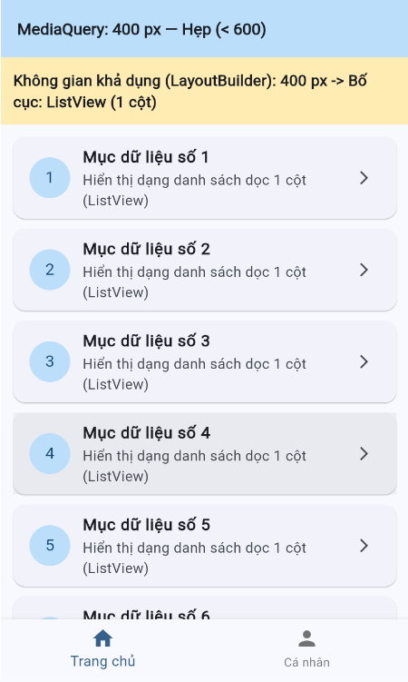
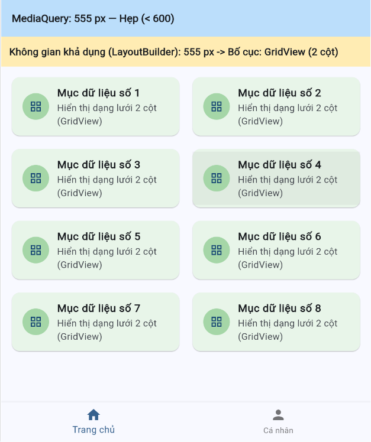
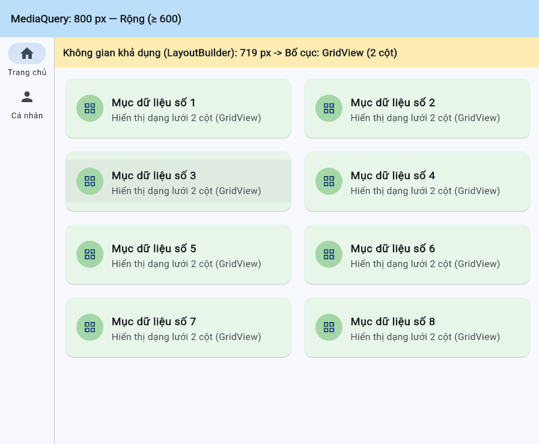

# Báo Cáo Chuyên Đề: Responsive & Adaptive UI trong Flutter

**Học phần:** Lập trình đa nền tảng  
**Giảng viên hướng dẫn (GVHD):** TS. Nguyễn Duy Nhật Viễn  
**Đơn vị:** Khoa Điện tử và Trí tuệ Nhân tạo — Trường Đại học Bách Khoa, Đại học Đà Nẵng  

---

## 1. Thông tin nhóm & Bảng phân công công việc (WBS)

| STT | Họ và tên | MSSV | Nội dung công việc | Commit GitHub | Tỷ lệ đóng góp |
|:---:|:---|:---:|:---|:---|:---:|
| 1 | **Nguyễn Thái Hoàng** | 106230011 | Tìm hiểu lý thuyết Responsive/Adaptive, Breakpoint; lập trình khung điều hướng thích ứng với MediaQuery; soạn báo cáo & slide thuyết trình. | Commit: main.dart (Scaffold, MediaQuery, Navigation), README.md | 50% |
| 2 | **Lê Trương Uyển Nhi** | 106230054 | Tìm hiểu LayoutBuilder & nguyên tắc phương thức nhập liệu; lập trình vùng nội dung tự chuyển đổi ListView / GridView; kiểm thử & chụp kết quả demo. | Commit: main.dart (LayoutBuilder, ListView, GridView), /screenshots | 50% |

---

## 2. Mục tiêu và Kiến trúc giải pháp

Ứng dụng demo minh họa đầy đủ 2 cơ chế cốt lõi của giao diện đa nền tảng:
1. **Adaptive Navigation (Toàn màn hình với MediaQuery):**
   - Màn hình hẹp (< 600px): Sử dụng thanh điều hướng đáy `BottomNavigationBar` tối ưu cho thao tác chạm bằng ngón tay cái trên thiết bị di động.
   - Màn hình rộng (≥ 600px): Chuyển sang thanh điều hướng dọc bên trái `NavigationRail` kết hợp `VerticalDivider`, phù hợp với chuột và không gian ngang lớn trên Tablet/Desktop.
2. **Responsive Content (Cục bộ theo không gian khả dụng với LayoutBuilder):**
   - Đo chiều rộng thực tế `constraints.maxWidth` sau khi đã trừ hao 81px của `NavigationRail`.
   - Không gian hẹp (< 500px): Hiển thị dạng danh sách dọc 1 cột (`ListView.builder`).
   - Không gian rộng (≥ 500px): Hiển thị dạng lưới 2 cột (`GridView.builder`).

---

## 3. Hướng dẫn cài đặt và chạy ứng dụng

### Yêu cầu môi trường:
- Flutter SDK (phiên bản 3.0 trở lên)
- Trình duyệt Google Chrome hoặc thiết bị ảo / Windows Desktop support

### Các bước chạy:
```bash
# 1. Cài đặt các gói phụ thuộc (nếu cần)
flutter pub get

# 2. Chạy ứng dụng trên trình duyệt Chrome (khuyên dùng để test co giãn dễ nhất)
flutter run -d chrome

# Hoặc chạy trên môi trường Windows Desktop:
flutter run -d windows
```

> **Mẹo kiểm thử nhanh:** Trên Chrome, bạn chỉ cần mở rộng / thu nhỏ cửa sổ hoặc nhấn F12 bật *Device Toolbar* để thay đổi linh hoạt kích thước chiều rộng cửa sổ.

---

## 4. Kết quả thực nghiệm và Ảnh chụp màn hình

| Trường hợp 1: Màn hình hẹp (< 500px) | Trường hợp 2: Chuyển tiếp (500–599px) | Trường hợp 3: Màn hình rộng (≥ 600px) |
|:---:|:---:|:---:|
| BottomNavigationBar + ListView 1 cột | BottomNavigationBar + GridView 2 cột | NavigationRail + GridView 2 cột |
|  |  |  |

---

## 5. Tài liệu tham khảo
- [1] Flutter Docs: *Creating responsive and adaptive apps*
- [2] Flutter Docs: *Best practices for adaptive design*
- [3] Flutter API: *MediaQuery class & LayoutBuilder class*
- [4] Material Design 3 Guidelines: *Window size classes & Breakpoints*
